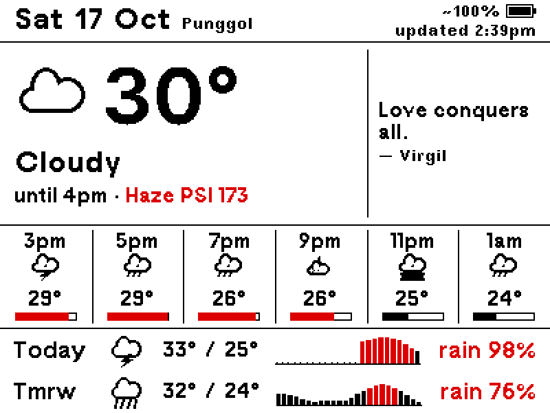
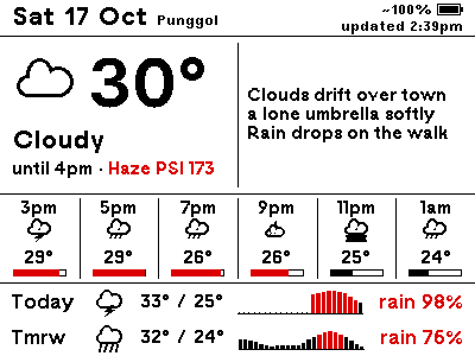
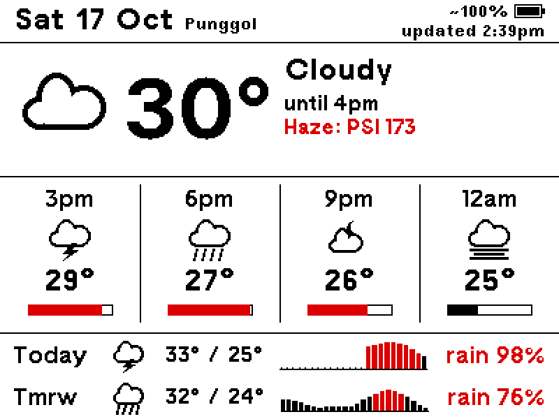
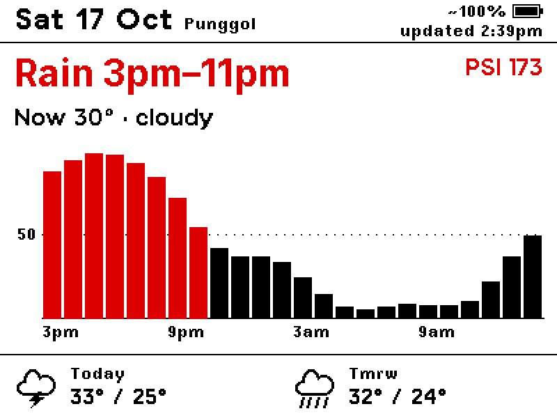
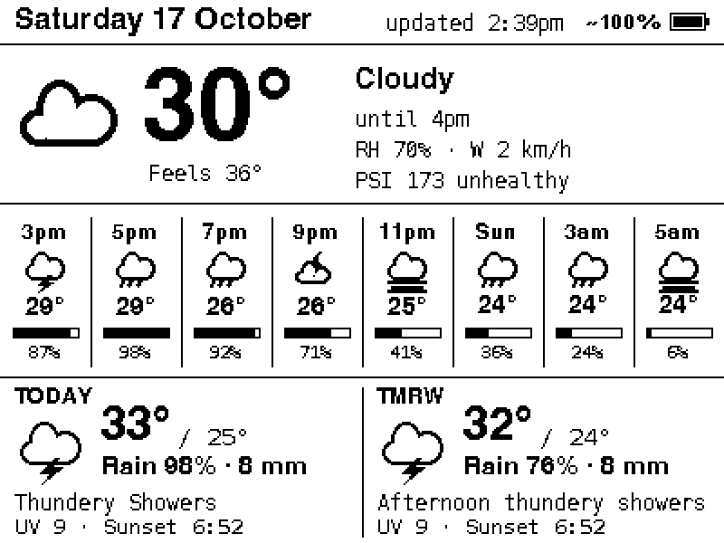

# nrf5-eink

A TRMNL-style dashboard for a cheap 4.2" Bluetooth e-ink tag (nRF52811, 400×300).
The Mac renders screens with Pillow and pushes them over BLE. The display itself is passive.

- **Device reference (hardware, firmware, BLE protocol, quirks):** [docs/DEVICE.md](docs/DEVICE.md)
- **What the board and panel can do (capability matrix):** [docs/CAPABILITIES.md](docs/CAPABILITIES.md)
- **Device:** `NRF_EPD_5E5D`, a non-public variant of [tsl0922/EPD-nRF5](https://github.com/tsl0922/EPD-nRF5) firmware (`v1.10-nrf52811`)

## Current state (2026-10-16)

- **On the display:** `proverb`, the default: weather + proverb of the day, with rain sparklines, red accents (wet hours, haze) and a battery meter top right.
- **Updates:** homelab-hq pushes every 30 min from 07:00 to 23:00 and wipes at 00:01, just after the firmware's own midnight calendar redraw, so the screen shows a fresh dashboard overnight. If the Mac stops, the firmware's calendar takes over at the next midnight.
- **Five layouts** to switch between (below). The `note` haiku layout needs `OPENROUTER_API_KEY` in `.env` (present on this Mac).
- **Known limits:** no live clock (see below), battery % is an estimate (the firmware measures the regulated rail), the firmware's 15 image slots remain undiscovered.

## Available dashboards

Switch with `uv run python -m epd.cli use <name>` (then `--push`, or wait for the next scheduled push). `list` shows the current one.

| `proverb`: weather + proverb of the day (default) | `note`: weather + LLM haiku |
| --- | --- |
|  |  |
| 4/6 now block, 2/6 proverb panel, 6 × 2-hourly slots | 3/6 now block, 3/6 haiku panel, 6 × 2-hourly slots |
| **`glance`**: weather at a glance | **`rain`**: when will it rain? |
|  |  |
| Big now block, 4 × 3-hourly slots | Rain-window headline, 24 h rain chart |
| **`at-a-glance`**: today + the week ahead | **`detailed`**: the original, dense layout |
|  |  |
| Date, today's weather, month · 7-day agenda from macOS Calendar | Everything at once; too cluttered to read on the panel, kept for reference |

Exact frames as sent to the panel (black, white, red), shown at 2×, with live Punggol data from a hazy October evening. Regenerate with `uv run python tools/screenshots.py`.

## Quick start

```sh
uv run python -m epd.cli --push                  # push the current layout (config.toml) (~40 s)
uv run python -m epd.cli --push --wipe           # full clear first (~70 s); ~once a day for ghosting
uv run python -m epd.cli list                    # layouts; * marks the current one
uv run python -m epd.cli use rain                # switch the current layout (takes effect on the next push)
uv run python -m epd.cli rain --preview out.png  # render any layout without pushing (--bat 2800 to show BATT LOW)
uv run python tools/info.py                      # what the device reports (config, battery, clock)
uv run python tools/testcard.py                  # black/white test card
```

Requirements: macOS with Bluetooth, [uv](https://docs.astral.sh/uv/). Dependencies: `bleak`, `pillow`.
Close any browser/web-tool connection to the display first; it accepts one central at a time.

## Layouts

Switch with `epd.cli use <name>`. The choice is stored in [`config.toml`](config.toml) along with the location (Punggol, 1.4043, 103.9021).

| Name | What it shows | Use when |
| --- | --- | --- |
| `glance` (layout A) | Header · big icon + temperature (top-aligned with the condition), NEA condition, "until 6.30pm", haze line unless PSI is "Good" (≤ 50), red once "Unhealthy" (> 100) · next 12 h as 4 slots 3 h apart (hour, icon, temp, rain bar) · Today and Tmrw as one line each (icon, high/low, 24 h rain sparkline, rain %) | Everyday |
| `rain` (layout B) | Header · headline that answers "when does it rain?" ("Rain 6pm–9pm", "Rain tmrw from 11am", "Dry next 24 hours") + PSI unless "Good" (red when > 100) · "Now 30° · thundery showers" · 24 h chance-of-rain bar chart with a dotted 50% line · Today/Tmrw high/low | Wet-season days |
| `note` | Header · compact now block (icon + temperature, condition, until/haze) spanning 3 of 6 columns, haiku panel the other 3 · side panel with an **LLM-written weather haiku** · next 12 h as 6 slots 2 h apart · Today/Tmrw lines with rain sparklines | When you want a little personality |
| `proverb` **(default)** | Same structure as `note`, but the main block spans 4 of 6 columns and the 2/6 panel shows the **proverb of the day** from [`data/proverbs.json`](data/proverbs.json) with its origin | Calm, no network beyond the weather |
| `at-a-glance` | No shared header. Left 140 px: weekday, big day number with month over year, today's icon + high/low, condition, rain % · month grid (Monday first; today a red box; Sundays and Singapore public holidays red) · battery meter bottom-left. Right 260 px: **agenda** of the next 7 days from macOS Calendar, grouped by day (Today always, empty days skipped), "all day" or 24 h start time + title (Workato rows red), dated **reminders** with a hollow circle and red time (overdue ones under Today), "+N more" when it runs out of room · "updated 04:41" bottom-right | Days with plans |
| `auto` | Not a layout of its own: picks **`rain`** when a lot of rain is coming, else **`proverb`**. Before noon, any hour left today with chance ≥ 50% counts (you're still planning the day); from noon, only the next 6 h count and they need ≥ 70%. Rain falling now (NEA nowcast) always counts. Each push logs its choice (`auto: rain (98% at 17:00)`) | Leave it on: the 30-min schedule then follows the weather |
| `detailed` | The original dense screen: now block with RH/wind/PSI, 8 hourly slots 2 h apart, Today/Tmrw cards with rain mm, UV, sunset | Reference only. Too dense to read on the panel |

The shared header (`proverb`, `note`, `glance`, `rain`; `detailed` has its own, `at-a-glance` has none): date with the place beside it on the left; on the right, the **battery meter, always in the top-right corner of every dashboard** (glyph like the firmware calendar's + `~68%`, red with LOW below 30 %), above a small **"updated 9:04pm"** stamp in the smallest readable font (TRMNL12). The stamp is deliberately tiny so it isn't read as a live clock.

### Why there's no live clock

The panel only changes when something pushes a new frame, so the time on our dashboards is the time of the last update, not "now". A clock that ticks every minute is only possible in the firmware's own **clock mode** (`SET_TIME` with mode 2), which comes with trade-offs:

- **It's the firmware's screen, not ours.** Clock mode draws a built-in date/clock layout. It can't be combined with a pushed dashboard: arming it replaces our picture within a minute.
- **Every minute is a full refresh.** The whole panel flashes each minute (about 1,440 refreshes a day). Upstream warns against leaving it on long-term; the battery lasts roughly weeks to a couple of months instead of much longer.
- **Partial refresh (redraw only a small clock box) needs new firmware.** One fork, [zhyiheihei/EPD-nRF5](https://github.com/zhyiheihei/EPD-nRF5), adds a ~4 s partial refresh for a 7.5" panel. This unit runs a non-public firmware variant with an unknown update key and no debug probe attached, so flashing custom firmware isn't safe.
- **Pushing from the Mac every minute isn't practical.** A push takes about 40 s (most of it waiting for the refresh to finish), flashes the whole screen, and keeps Bluetooth busy all day.

So the dashboards show a small "last updated" stamp instead, kept fresh by the scheduled push every 30 minutes (see [Scheduling](#scheduling-homelab-hq)). See docs/DEVICE.md §6 for the firmware details.

All layouts share one data fetch (`screens/weather.py: fetch`): Open-Meteo (current, hourly, daily) + NEA (2-hour area nowcast, 24-h forecast, 4-day outlook, PSI for the nearest region).

### Proverb of the day (`proverb` layout)

[`data/proverbs.json`](data/proverbs.json) holds 366 entries, one per calendar day (`"01-01"` … `"12-31"`, including `"02-29"`):

```json
{"date": "10-16", "text": "The habit does not make the monk.", "by": "French proverb"}
```

- 366 unique proverbs from 87 origins, including Malay peribahasa, English weather lore, the Analects, Laozi and Latin sayings. Shuffled so neighbouring days have different origins.
- Every entry was checked against the real 2/6 panel: it fits with its attribution (361 at 14 px, 5 at 12 px). To edit one, keep it short and run a preview for that date.
- Origins follow the attributions common in proverb collections. Folk sayings rarely have a verifiable single source; famous-person quotes that are often misattributed were left out.

### LLM haiku (`note` layout)

The side panel shows a haiku about today's forecast, written by a model on [OpenRouter](https://openrouter.ai/).

1. `cp .env.example .env` (already done on the Mac mini) and paste your key: `OPENROUTER_API_KEY=sk-or-...`. `.env` is gitignored.
2. `OPENROUTER_MODEL` defaults to `openrouter/free` ([Free Models Router](https://openrouter.ai/docs/guides/routing/routers/free-router): a random free model per request, rate limited).
3. Preview: `uv run python -m epd.cli note --preview out.png` prints the haiku and which model wrote it.

How it works (`screens/quip.py`):
- **Prompt facts:** now, condition and until-time, feels-like, rain window and 2-hourly chances, today/tomorrow (incl. NEA text and UV), PSI with an N95 note above 200. The model must weave the one practical thing (umbrella, mask, shade/water) into a quiet image: 5-7-5, no puns, no emoji.
- **Validation:** exactly 3 lines, 8–22 words, and it must fit the panel at 14 px. Otherwise it retries once with feedback, then falls back to `[note]` in `config.toml`.
- **Caching:** `.cache/quip.json`, regenerated only when the situation changes (condition, until-time, rain window, haze band, or a new 3-hour block). Delete the file to force a new haiku.
- **Panel:** keeps the haiku's line breaks, indents wrapped continuations, and auto-fits (NicoClean 14 px, else TRMNL12 at 12 px).

### macOS Calendar (`at-a-glance` layout)

[`epd/events.py`](epd/events.py) builds [`tools/calendar_export.swift`](tools/calendar_export.swift) (EventKit) into a tiny app bundle, `.cache/CalendarExport.app`, and starts it with `open`, so it is its own process for macOS privacy: one Calendars grant for **"nrf5-eink calendar export"** (System Settings → Privacy & Security → Calendars) works from a terminal and under launchd alike. A bare CLI would inherit the terminal's or bun's grant instead, and neither has Calendars.

- Every calendar macOS Calendar syncs is included (iCloud, Gmail, work Google, Holidays in Singapore, Birthdays), except those in `config.toml` `[calendar] exclude` (currently `Routines`), so newly added accounts show up on their own.
- Invites appear only once accepted: your own events and accepted invites show; pending, tentative and declined ones don't. Exact duplicates (same title and times, e.g. one meeting on two calendars) show once.
- Events from the accounts in `[calendar] red_sources` (currently `Workato`) are drawn with the whole row in red.
- Reminders with a due date join the agenda as Calendar.app shows them, marked with a small hollow circle (like Reminders' checkbox) before the title and the time in red ("due" when they have no time). Overdue reminders that aren't done yet go under Today, oldest first, with their due date in place of the time. They're read from the trml-byos Reminders export (`[calendar] reminders`, refreshed every 5 min by the `trml-reminders` hq job), so this app needs no Reminders permission. Reminders without a due date are left out.
- Each export is cached in `.cache/events.json`. If one fails, the last good export is drawn and the stamp turns red with "calendar offline".

### Adding a layout

1. Create `screens/<name>.py` with `render(data, now=None, battery_mv=None) -> PIL.Image` (400×300). Reuse `fetch` from `screens.weather` and the helpers in `screens/common.py` (`Forecast`, `canvas`, `bold`, `regular`, `text_mid`, `text_top`, `icon_mid`, `rain_bar`, `hour`).
2. Position with `text_mid` / `text_top` / `icon_mid`, never raw `d.text` offsets, so rows stay aligned.
3. Register it in `SCREENS` in `epd/cli.py`.
4. Preview, check it, then push.

### Interface for the command centre (`hq`)

The command centre (separate project, see below) drives this repo only through the CLI:

| Action | Command (cwd = this repo) |
| --- | --- |
| Scheduled push | `uv run python -m epd.cli --push` (exit 0 = pushed; non-zero = failed; one summary line on stdout) |
| Daily ghosting wipe | `uv run python -m epd.cli --push --wipe` |
| List layouts / current | `uv run python -m epd.cli list` (`*` marks current) |
| Change layout | `uv run python -m epd.cli use <name>`, optionally followed by a push to apply it immediately |

## Code

```
config.toml   current layout + location (edited by `epd.cli use`)
fonts/        TRMNL pixel fonts + Inter (OFL), see fonts/README.md
data/proverbs.json  proverb of the day, one per MM-DD
epd/
  device.py   BLE client: connect, INIT, image upload (RLE), CLEAR, SET_TIME, SET_CONFIG, clock drift
  image.py    PIL image -> 1-bit planes (+ preview)
  rle.py      RLE codec matching the firmware
  llm.py      OpenRouter chat client (stdlib), reads .env
  events.py   macOS Calendar events (builds + runs the EventKit exporter app, caches, groups by day)
  data.py     cached JSON fetcher (data.gov.sg rate-limits hard; falls back to the last good copy)
  icons.py    weather glyphs drawn with PIL primitives (crisp at 1 bit), WMO + NEA text -> icon
  cli.py      layouts registry, push/preview, `use`, `list`
screens/
  weather.py  data fetch + the `detailed` layout
  common.py   shared header, fonts, Forecast helper (rain windows, night), rain bars
  glance.py   layout A
  rain.py     layout B
  note.py     side-panel dashboard (`layout()`), haiku variant at 3/6
  proverb.py  proverb variant at 2/6, reads data/proverbs.json
  at_a_glance.py  `at-a-glance`: date, weather + month | 7-day agenda
  quip.py     OpenRouter haiku: prompt, validation, cache
tools/
  info.py, testcard.py
  calendar_export.swift (+ .plist)  EventKit exporter used by epd/events.py
  screenshots.py  regenerates docs/images/<layout>.png for this README
  experiments/  red_card.py (B/W/R test card + refresh timing), raw_ssd1619_probe.py, gatt_dump.py,
                and the early red probes from before the refresh-timing fix
docs/DEVICE.md  everything known about the device
```

## Scheduling (homelab-hq)

Pushes are scheduled by **homelab-hq** (`~/Developer/potateros/homelab-hq`), the Mac mini's job command centre. Its `jobs.toml` owns two jobs for this repo:

| Job | Command (cwd = this repo) | When |
| --- | --- | --- |
| `eink-weather` | `uv run python -m epd.cli --push` | every 30 min, skipped 23:00–07:00, 5 min timeout |
| `eink-wipe` | `uv run python -m epd.cli --push --wipe` | 00:01 daily (clears ghosting; one minute after the firmware's midnight redraw so they don't collide) |

- The jobs push **whatever `config.toml` says**. `epd.cli use <name>` changes what the next scheduled push shows; with `auto`, each push re-decides between `rain` and `proverb`.
- `hq status` shows last and next runs, `hq logs eink-weather` shows push output (`pushed proverb (battery … mV …)`), and `hq run eink-weather --manual` pushes now.
- **One Bluetooth connection at a time:** a manual push or experiment while a scheduled push is running will make one of them fail. For longer manual sessions, use `hq hold eink-weather` first and `hq resume eink-weather` after.
- **Bluetooth permission:** under launchd, macOS asks on behalf of `bun` (hq's runner), not your terminal. If pushes fail with `Bluetooth access is denied by the user`, allow `~/.bun/bin/bun` in System Settings → Privacy & Security → Bluetooth. Upgrading bun may need the grant again. It's granted on this Mac as of 2026-10-16.
- The Mac must stay awake (display sleep is fine). If pushes stop, the midnight calendar fallback takes over.

## How a push works

1. Scan for `NRF_EPD*` (up to 45 s; it advertises intermittently) and connect.
2. `INIT` → the device notifies config, `slots`, `sid`, `mtu`, `t=<local time> bat=<mV>`.
3. Render the layout, using the battery level it just reported.
4. If the device clock is more than 30 s off: `SET_TIME`, then wait 25 s (it triggers a built-in redraw that runs in the background).
5. (`--wipe` only: `CLEAR`, wait 25 s.) `INIT` → black plane + all-white red plane → `REFRESH` → **hold the connection 30 s**. Disconnecting powers the panel down, and doing it mid-refresh freezes the screen inverted or black.
6. `SET_CONFIG` with display_mode = calendar: the **dead-man fallback** (below).

If the data fetch fails but the device is reachable, it shows the firmware's built-in calendar instead of a stale forecast.

### Dead-man fallback

The display can't detect staleness itself. But the firmware redraws its own calendar at **local midnight** when in calendar mode. So every push leaves the picture on screen with calendar mode armed. If pushes stop, the built-in date view takes over at midnight, exactly when the "Today/Tmrw" forecast becomes wrong. Clock mode can't be armed this way: it redraws every minute and would replace the picture immediately. See DEVICE.md §7.

## Data notes

- data.gov.sg (`api-open.data.gov.sg/v2/real-time/api/…`) needs a User-Agent and rate-limits at a few requests per ~10 s. Responses are cached in `.cache/`.
- NEA has no rain percentage. Rain % and the rain windows come from Open-Meteo's hourly model.
- Open-Meteo's PM2.5 model badly underestimated the Oct 2026 haze (≈83 vs NEA's measured 182 µg/m³), so air quality uses NEA only.
- The NEA nowcast overrides the model's current condition (the model said "Mostly clear" during showers).
- Update cadence: NEA nowcast every 30 min, PSI hourly, Open-Meteo models every 1–3 h → **push every 30 min** during the day.

## Design decisions (from the owner)

- **Readable from across the desk beats complete.** The dense layout was too hard to read; `glance` keeps body text ≥ 16 px and labels ≥ 12 px, and drops UV, sunset, wind, rain mm.
- **Fonts: the TRMNL type system** ([fonts/](fonts/README.md), SIL OFL, from the [TRMNL framework](https://github.com/usetrmnl/trmnl-framework)). TRMNL12/16/21 Bold are pixel fonts drawn for 1-bit screens and used at their native sizes only; `bold(size)` snaps to 12/16/21, and from 26 px up it uses Inter Bold. History: Helvetica broke up without anti-aliasing, Menlo was rejected as monospace, Verdana looked too wide and heavy, so we matched what [TRMNL uses on 1-bit screens](https://trmnl.com/framework/docs/3.4/font_family). Weights: **bold** only for numbers, the date and the condition; **medium** (`medium(size)`) for body text and labels: **NicoClean**, TRMNL's classic body pixel font, evenly weighted and between TRMNL Regular (too thin) and Bold (too heavy); clean at 14–16 px, with TRMNL12 Bold for 12 px labels. Rejected along the way: a 1-px double-strike "medium" (uneven: thick verticals, thin curves) and Monaspace Argon (outline font, so strokes snap unevenly at 1 bit). Rendered with anti-aliasing off. The `detailed` layout still uses Helvetica Bold + Menlo.
- The condition in `glance` wraps onto two lines at 21 px instead of shrinking, so it stays the most prominent text in its column; NEA's "(Day)/(Night)" suffix is dropped (the icon shows it).
- **Alignment is computed, not eyeballed:** `text_mid` centres text on its cap height, `text_top` puts the cap top on a line, `icon_mid` centres icon boxes. Rows share a centre line, and the header shares a baseline.
- Weather first. Air quality appears whenever PSI is above "Good" (> 50), in red once "Unhealthy" (> 100); it used to be > 100 only, lowered so the owner can track the October 2026 haze (owner, 2026-10-17). The battery meter is always shown, top right (owner, 2026-10-16). Exception: `at-a-glance` has no header, so its meter sits bottom-left, the emptiest corner (owner, 2026-10-17).
- `at-a-glance` (owner, 2026-10-17): a 140 | 260 split (the 300 | 500 idea scaled to 400 px, then narrowed from 150 so titles fit; 130 cramped the month grid); an agenda, not a schedule (no time grid, empty days skipped); 24 h times; Sundays red rather than shaded (the panel has no grey, and a dot pattern broke up the digits); red also marks today and holidays, a deliberate step beyond red-as-signal for this layout; only accepted invites.
- Header is black on white with a rule underneath (white-on-black was hard to read). The update time is a small two-line "last updated" stamp, not a clock.
- Divider lines are 1 px.
- **Red is a signal colour** (since 2026-10-16): only for what you might act on. Wet hours (≥ 50 % chance) in rain bars, sparklines and the `rain` chart; the Today/Tmrw rain % while wet hours are still ahead; the haze line / PSI; the `rain` headline when rain is coming; the battery meter when LOW. Everything else stays black. Drawn with `screens.common.RED` and pushed as a separate red plane.
- Battery is an **estimated percentage** using the firmware's own curve (upstream `batt_cal`), so it matches the calendar's glyph. The firmware measures the ~3.0 V rail (≈2.91 V ≈ ~68 %), not the 1100 mAh cell, so the number sits flat for most of the cell's life and drops near the end: charge when it turns red (< 30 %). Readings are logged to `.cache/battery.csv` for a future days-left estimate.
- **Today/Tmrw rain sparkline** (`common.day_row`, shared by `glance`, `note`, `proverb`): 24 bars, one per hour, for that day's chance of rain, filling the gap between high/low and rain %. Today's past hours shrink to dots on the baseline, so the bars show what's still ahead. Chosen over a text rain window, UV, condition word, rain mm, sun times and feels-like.
- In `glance`, the big temperature is vertically centred on the weather icon; the condition column is top-aligned beside it.
- Pushes skip the full clear (40 s instead of 70 s). A wipe once a day handles ghosting.

## Panel constraints

- 400×300, black/white/red. Red uploads work (red plane 0 = red, `to_planes(img, red=True, dither=False)`), sharp down to 1 px lines and 16 px text. See [CAPABILITIES.md](docs/CAPABILITIES.md).
- Every update is a full refresh with flashing (~22 s on the panel, red last), about 40 s end to end including the 30 s hold.
- No grey: avoid dithering text; use solid shapes, outlines and bars.

## Ideas / backlog

- [x] Schedule: push every 30 min 07:00–23:00 and a 00:01 wipe, via [homelab-hq](#scheduling-homelab-hq)
- [ ] Switch layouts from the hq TUI (per-job action calling `epd.cli use <name>`)
- [ ] Time-aware layout (C): after ~6 pm put tomorrow in focus
- [x] Retest red uploads: red works (2026-10-16). Next: use it in layouts (rain bars, haze alert)
- [ ] Rotating screens: agenda (macOS Calendar / ICS), month calendar, fun slot
- [ ] Haze alert screen: full-screen warning if PSI > 300
- [ ] Clock options (see "Why there's no live clock"): firmware clock mode at night only, or partial refresh if custom firmware ever becomes safe to flash
- [ ] Fun slots: bus/MRT arrivals (LTA DataMall key), dithered photo, xkcd, GitHub contributions, quote of the day, a Claude-written daily summary
- [ ] Investigate the firmware's 15 image "slots": could the device rotate stored images on its own?
- [ ] Measure clock drift over a day (log `t=` vs host time)
