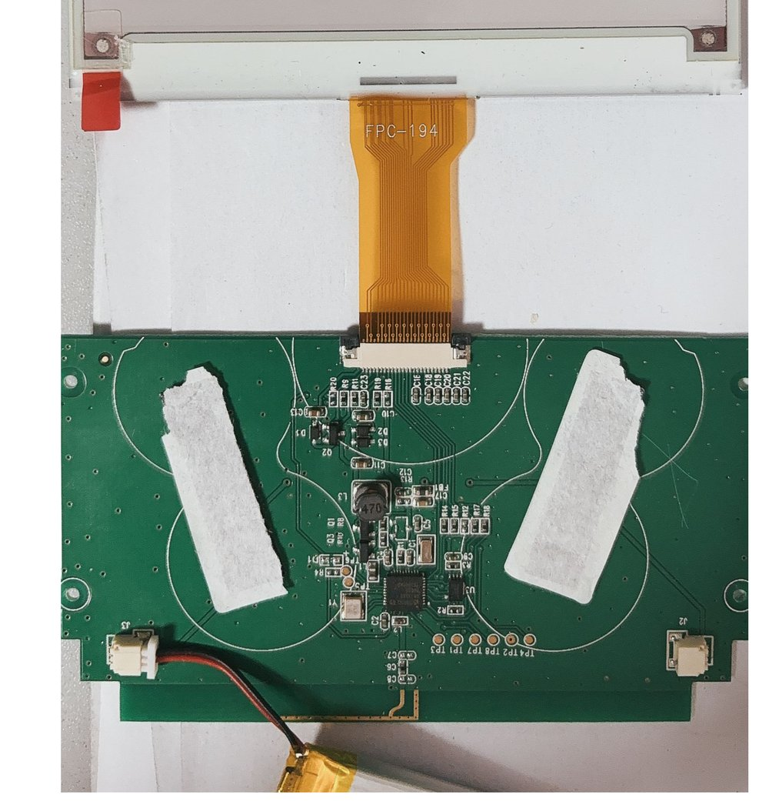
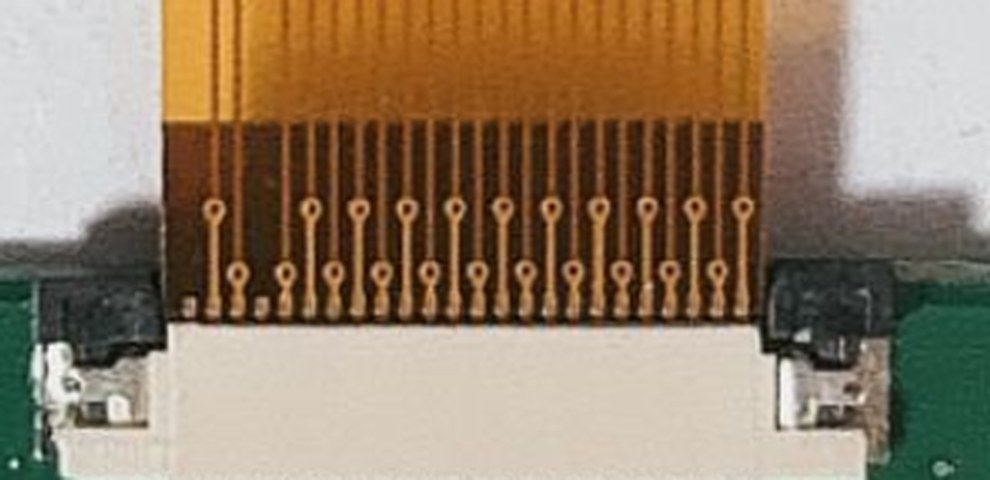
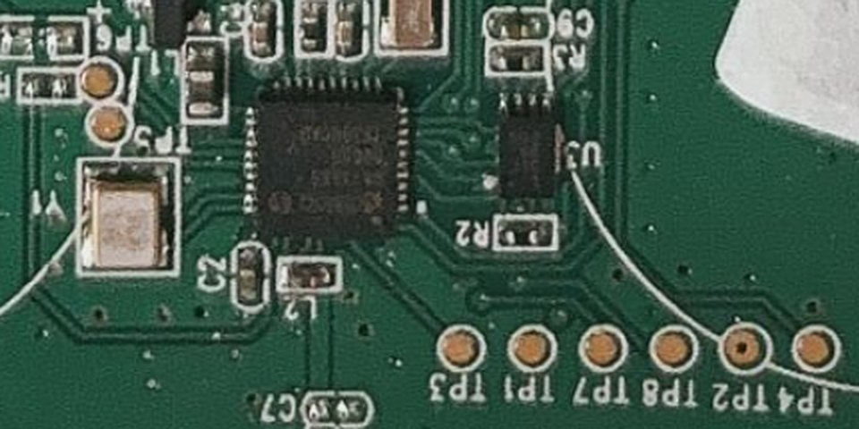
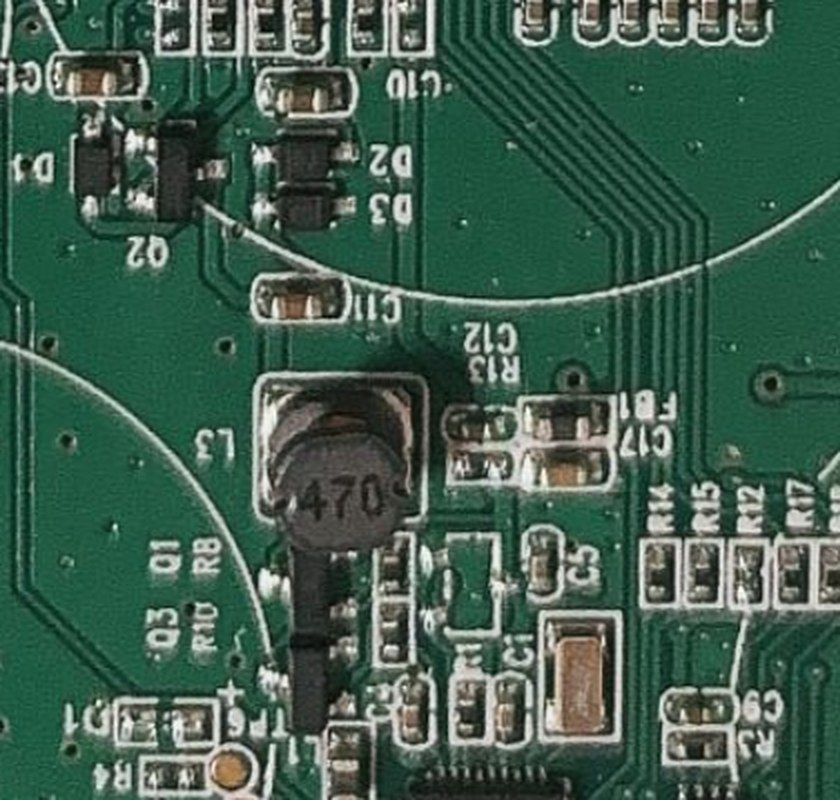

# Hardware and panel-level reference: 4.2" nRF52811 e-ink tag

How the `NRF_EPD_5E5D` tag works below the BLE protocol: the board, the panel interface, the SPI command sequence that draws a frame, and how to replace the nRF52811 with an ESP32. The BLE protocol, the vendor firmware's quirks and the slot system are in [DEVICE.md](DEVICE.md); this document covers the layers under them.

Status tags as in DEVICE.md: **[verified]** observed on this unit · **[source]** read in upstream firmware code ([tsl0922/EPD-nRF5](https://github.com/tsl0922/EPD-nRF5), tree `7e31961`) · **[photo]** read off the owner's teardown photo · **[online]** third-party docs or common knowledge of this panel family, not checked on this unit · **[recall]** general knowledge of this panel family that we couldn't confirm against a fetched source (Waveshare's wiki was down when this was written): treat as a starting point, check before relying on it · **[open]** unknown.

Contents: [1 Block diagram](#1-block-diagram) · [2 The board](#2-the-board) · [3 Panel interface](#3-panel-interface) · [4 Driving the panel (SPI command level)](#4-driving-the-panel-spi-command-level) · [5 How the nRF firmware is organised](#5-how-the-nrf-firmware-is-organised) · [6 Replacing the nRF52811 with an ESP32](#6-replacing-the-nrf52811-with-an-esp32) · [7 Open questions](#7-open-questions)

## 1. Block diagram

```
 Li-ion 1100 mAh ──J3──► regulator (~2.9 V rail) ──► nRF52811 ──────────── PCB trace antenna (BLE)
                                                     │  4-wire SPI + DC/RST/BUSY/BS
                                                     │  EN (P0.07) ─► panel power
                                                     ▼
                                          high-voltage booster (Q2, L3 47 µH, D1–D3, C16–C22)
                                                     │
                                          24-pin 0.5 mm FPC, ZIF socket
                                                     ▼
                         panel glass with an SSD1619-compatible controller on the glass:
                         BW RAM (0x24) + red RAM (0x26), waveform LUTs in OTP, internal temp sensor
```

The microcontroller never generates a waveform. It writes two 1-bit frame buffers into the controller on the glass over SPI and tells it to refresh. The controller runs the ~22 s black/white/red waveform by itself, powered by the board's booster. **Talking to the panel is SPI only; there is no I2C between the MCU and the panel.** The only I2C-like pins on the ribbon (TSCL/TSDA) let the panel controller read an optional external temperature sensor, and this design uses the controller's internal sensor instead (§3.3).

## 2. The board



*Owner's unit, case opened, 2026-11-17. Panel glass at the top, driver board below, battery lead on J3 (bottom left).* [photo]

This is a repurposed Hema (盒马) supermarket shelf-label board. The silkscreen has outlines for **four coin cells**: the original label ran on them. The seller wired a Li-ion cell to J3 instead, so the firmware's battery reading still follows a coin-cell curve (DEVICE.md §1).

| Ref | What it is | Status |
| --- | --- | --- |
| MCU (centre, QFN-32; refdes not visible) | **nRF52811** BLE SoC (Cortex-M4, 192 KB flash, 24 KB RAM). Marking unreadable in the photo; part confirmed by the firmware's version string | [verified] firmware / [photo] package |
| U3 (8-pin, right of the MCU) | Unidentified. Likely candidates: **SPI NOR flash** (would explain how 15 full frames are stored, see DEVICE.md §2.0c) or a Li-ion charger. Read the marking to settle it | [photo] / [open] |
| Y1 (metal can, left of the MCU) and the second crystal near C1 | Crystals: the nRF52 needs a 32 MHz one and usually has a 32.768 kHz one for the RTC | [photo] / [recall] roles |
| L2, C2 (below the MCU) | Probably the nRF's DC/DC or RF matching parts | [photo] / [open] |
| Bottom edge copper | PCB trace antenna, fed from the MCU through the C6–C8 matching network | [photo] |
| Q2, D1, D2/D3, L3 "470", C10–C13 | **High-voltage booster** for the panel (§3.4) | [photo] / [recall] role |
| C16–C22 (row behind the socket) | Panel supply capacitors (VSH, VSL, PREVGH, PREVGL, VCOM, VDD…) | [photo] / [recall] role |
| R9–R20 (around the socket) | Booster sense resistor (RESE) and pull-ups/series resistors on the panel lines | [photo] / [open] values |
| Q1, Q3, L1, R8, R10 (left of L3) | Probably the panel power switch driven by EN (P0.07) and/or the battery regulator | [photo] / [open] |
| ZIF socket (top edge) | 24-pin, 0.5 mm pitch, flip-lock latch. Ribbon marked `FPC-194` | [photo] |
| J3 | Battery connector (2-pin, red/black lead) | [photo] |
| J2 | Second 2-pin connector, unpopulated cable. Purpose unknown (external power? the original coin-cell tags had none) | [photo] / [open] |
| TP1–TP8 | Test pads. **TP3 TP1 TP7 TP8 TP2 TP4** sit in a row below the MCU: almost certainly the SWD programming header (SWDIO, SWDCLK, VDD, GND, RESET + one spare). TP5/TP6 are near the crystal and the booster. Not traced | [photo] / [open] mapping |

<p>


</p>
<p></p>

*Left: the ribbon's 24 contacts (22 traced + 2 short pads) in the latch. Right: MCU, U3 and the TP row. Below: the booster (Q2, D1–D3, L3).* [photo]

## 3. Panel interface

### 3.1 Signals and nRF pins

From the device's config block (DEVICE.md §3), whose layout and defaults match upstream's `EPD_CFG_52811` exactly except for the model id.

| Signal | nRF52811 pin | Direction | Behaviour (upstream `EPD/EPD_driver.c`) | Status |
| --- | --- | --- | --- | --- |
| MOSI (SDA/DIN) | P0.20 | out, briefly in | SPI data. Upstream flips it to an input to read the temperature register: the controller's SPI data line is bidirectional, there is no MISO | [verified] config / [source] |
| SCLK | P0.19 | out | SPI clock | [verified] / [source] |
| CS | P0.06 | out | Chip select, active low, driven by the nRF SPI peripheral per transfer | [verified] / [source] |
| DC | P0.05 | out | **Low = command byte, high = data/parameter bytes** | [verified] / [source] |
| RST | P0.04 | out | Panel hardware reset, active low. Pulse: high 10 ms, low 10 ms, high 10 ms | [verified] / [source] |
| BUSY | P0.03 | in | **High while the controller is busy** (reset, refresh, temp read). Firmware polls it | [verified] / [source] |
| BS | P0.02 | out | Bus select. **Firmware drives it low = 4-wire SPI** (with DC). High would be 3-wire, 9-bit SPI | [source] / [recall] meaning |
| EN | P0.07 | out | **Panel power, active high.** High in `EPD_GPIO_Init`, low in `EPD_GPIO_Uninit` | [source] |
| LED | P0.18 | out | Status LED; toggled every 100 ms while waiting on BUSY | [source] |
| Wake-up | none (`0xFF`) | — | No wake coil on this unit, so it never deep-sleeps and keeps advertising | [verified] |

### 3.2 24-pin FPC pinout

The usual layout for SSD16xx-driven Good Display/Waveshare SPI panels, from memory rather than a datasheet. **Not traced on this unit and not confirmed against a datasheet**; check pin 1 and the trace pattern against the ribbon before relying on it.

| Pin | Name | Function |
| --- | --- | --- |
| 1 | NC | — |
| 2 | GDR | Gate drive output to the booster MOSFET (Q2) |
| 3 | RESE | Booster current-sense input (sense resistor to GND) |
| 4 | varies | NC, VGL, or a second source supply (VSH2) on some red panels |
| 5 | varies | NC or VGH, depending on the panel |
| 6 | TSCL | I2C clock **to an external temperature sensor** (controller is master; unused here) |
| 7 | TSDA | I2C data for the same sensor (unused here) |
| 8 | BS1 | Bus select: low = 4-wire SPI, high = 3-wire SPI |
| 9 | BUSY | Busy output |
| 10 | RES# | Reset, active low |
| 11 | D/C# | Data/command select |
| 12 | CS# | Chip select, active low |
| 13 | SCL | SPI clock |
| 14 | SDA | SPI data (bidirectional) |
| 15 | VDDIO | I/O supply |
| 16 | VCI | Main supply (3.3 V on driver boards) |
| 17 | VSS | Ground |
| 18 | VDD | Core regulator output (capacitor only) |
| 19 | VPP | OTP programming voltage (leave open) |
| 20 | VSH | Positive source voltage (capacitor) |
| 21 | PREVGH | Positive gate voltage (from the booster) |
| 22 | VSL | Negative source voltage (capacitor) |
| 23 | PREVGL | Negative gate voltage (from the booster) |
| 24 | VCOM | Common electrode voltage (capacitor) |

[recall] (pin names) / [photo] (24 contacts). The Good Display datasheet for GDEY042Z98 (4.2" B/W/R, SSD1683, same family) or Waveshare's "4.2inch e-Paper Module (B)" schematic would confirm it.

### 3.3 Temperature compensation

E-ink waveforms depend on temperature, so the controller measures it before each refresh. Upstream sets `0x18 0x80` (use the **internal** sensor) at init, and the refresh's `0x22 0xF7` sequence loads the temperature and picks the matching waveform from OTP. To read it: `0x22 0xB1`, `0x20`, wait for BUSY, `0x1B`, then read one data byte (signed °C). [source]

### 3.4 High-voltage booster

The glass needs roughly +15/−15 V source and ±20 V gate voltages. The controller produces them with an **external boost converter**: it switches a MOSFET through **GDR**, the MOSFET charges an inductor, diodes rectify the result onto PREVGH/PREVGL, and a resistor on **RESE** tells the controller the switch current. On this board that is Q2, L3 (47 µH, marked "470"), D1–D3 and the capacitors behind the socket. [photo] / [recall]

This is why **you can't wire a bare microcontroller straight to the ribbon**: whatever replaces the nRF52811 must keep this booster (§6, Option B) or bring its own (any "e-paper driver" board does, §6 Option A).

## 4. Driving the panel (SPI command level)

This is what the firmware does on the wire for this panel (upstream `EPD/SSD16xx.c`, model `SSD1619_420_BWR`, 400 × 300). The vendor variant reports model `0x16`, which isn't in upstream, but our raw `0x4E`/`0x4F`/`0x26` writes over BLE behave exactly as below (DEVICE.md §1, §5.3). [source] / [verified] RAM commands

**Framing.** A command is one byte with DC low; its parameters follow as bytes with DC high. CS goes low around each transfer. Commands that start internal work (reset, refresh) raise BUSY until done.

### 4.1 Init

| Step | Bytes (cmd: data) | Meaning |
| --- | --- | --- |
| 1 | RST high 10 ms → low 10 ms → high 10 ms | Hardware reset |
| 2 | `12` | Software reset; wait while BUSY high (~200 ms max) |
| 3 | `3C: 01` | Border waveform |
| 4 | `18: 80` | Use the internal temperature sensor |
| 5 | `11: 03` | Data entry: X increments, then Y |
| 6 | `44: 00 31` | RAM X window: bytes 0–49 (400 px / 8 − 1 = 0x31) |
| 7 | `45: 00 00 2B 01` | RAM Y window: rows 0–299 (0x012B), little-endian |
| 8 | `4E: 00` | RAM X counter = 0 |
| 9 | `4F: 00 00` | RAM Y counter = 0 |

Upstream writes no driver-output (`01`), booster (`0C`) or LUT (`32`) commands: it relies on the panel's OTP defaults. **Don't write OTP commands** (`36`, `37`, `38`, `39`, …); they are one-time programmable.

### 4.2 Frame data

| Step | Bytes | Meaning |
| --- | --- | --- |
| 1 | `24` + 15 000 bytes | Black/white RAM. 50 bytes per row × 300 rows, top row first, **bit 7 = leftmost pixel, 1 = white, 0 = black** |
| 2 | `26` + 15 000 bytes | Red RAM, same layout. With the refresh setting below, **0 = red, 1 = not red** |

These are exactly the two planes `epd.image.to_planes()` returns, before RLE. Always send the red plane, all `0xFF` if there is no red, or stale red RAM shows through (DEVICE.md, device rules).

### 4.3 Refresh and sleep

| Step | Bytes | Meaning |
| --- | --- | --- |
| 1 | `21: 80 00` | Display update control 1: **invert red RAM** (so 0 = red). Upstream uses `40 00` on B/W-only panels |
| 2 | `22: F7` | Update sequence: clock on, analog on, load temperature, load LUT, display, power off |
| 3 | `20` | Master activation: starts the refresh. BUSY goes high |
| 4 | wait for BUSY low | ~22 s on this panel (DEVICE.md §5.1). **Keep power on the whole time**: cutting it mid-refresh freezes the panel in an intermediate phase |
| 5 | re-send steps 5–9 of §4.1 | Upstream resets the RAM window after every refresh ("DO NOT REMOVE!") |
| 6 | `10: 01` | Deep sleep, then wait 100 ms. Leave it here; a hardware reset (§4.1 step 1) wakes it |

Clear = fill both RAMs with `0xFF` and refresh. Upstream has **no partial refresh** for SSD16xx; refreshes are always full-screen.

### 4.4 Mapping to the BLE protocol

The BLE commands in DEVICE.md §4 are thin wrappers over this:

| BLE | What it does at SPI level |
| --- | --- |
| `0x01` INIT | EN high, GPIO/SPI init, §4.1 |
| `0x02` CLEAR | Fill `24` and `26` with `FF` (+ refresh) |
| `0x03` SEND_CMD / `0x04` SEND_DATA | Raw command byte (DC low) / data bytes (DC high), passed straight through. Our `tools/experiments/raw_ssd1619_probe.py` uses these |
| `0x30` image upload | Decompress RLE and stream into `24`, then `26` (modern flag bits) |
| `0x05` REFRESH | §4.3 steps 1–4 |
| `0x06` SLEEP | §4.3 step 6 |

## 5. How the nRF firmware is organised

From upstream; the vendor variant adds slots, partial-refresh clock mode and model `0x16` on top (DEVICE.md §2). [source]

- **Driver abstraction.** Each controller family (`UC81xx.c`, `SSD16xx.c`, …) fills an `epd_driver_t`: `init`, `clear`, `write_image`, `write_ram`, `refresh`, `sleep`, `read_temp`, `read_busy`. A model (`epd_model_t`) pairs a driver with a colour mode, IC and resolution. Upstream model ids: `0x02` SSD1619 400×300 BWR, `0x04` SSD1619 400×300 BW, `0x01`/`0x03` UC8176 4.2" BW/BWR, up to `0x11`. An unknown id falls back to the first model (UC8176 BW), which is why sending the wrong id to INIT or erasing the config would break this unit's display.
- **Config block** (14 bytes in flash, DEVICE.md §3): pins, model id, wake-up pin, LED, EN, display mode, week start (+ the variant's current slot). Upstream's nRF52811 default is `14 13 06 05 04 03 02 02 FF 12 07`; this unit differs only in the model byte (`0x16`).
- **Battery.** The SAADC samples the nRF's own VDD pin (gain 1/6, internal reference, 10-bit) and scales by 3600/1024 to mV. It measures the regulated rail, not the cell (DEVICE.md §1).
- **Built-in screens.** Calendar and clock are drawn by the firmware into the same RAMs and refreshed at midnight (calendar) or every minute (clock).
- **Flashing.** Over SWD (J-Link or DAPLink on the TP pads) or Nordic Secure DFU over BLE. **Don't reflash this unit with upstream**: you'd lose the variant's slots and partial-refresh clock, and it isn't known whether the vendor bootloader accepts upstream's signing key (DEVICE.md §2). The community guide at [myetoys.com/tsl0922/17.html](https://www.myetoys.com/tsl0922/17.html) covers flashing these price-tag boards with a J-Link or DAPLink, lists the supported controllers (UC8176, UC8276, SSD1619, SSD1683, JD79668) and notes that a failed OTA leaves the board in its `DfuTarg` bootloader. The same site sells a paid port of this firmware for DA14585-based 4.2"+ tags ([/tsl0922/52.html](https://www.myetoys.com/tsl0922/52.html)) that adds experimental partial refresh for UC8176/SSD1619; it doesn't apply to this nRF52811 board. Neither page has a pinout or mentions ESP32. [online]

## 6. Replacing the nRF52811 with an ESP32

**Why you might:** Wi-Fi lets the panel fetch its own image (no Mac, no BLE scan, no 30 s hold), and you control the firmware, including partial refresh. **Costs:** much higher power draw (§6.4), and you lose the vendor firmware's slots, carousel and midnight calendar fallback unless you rebuild them. None of the options below are tested on this unit yet.

### 6.1 Option A (recommended): move the ribbon to an ESP32 e-paper driver board

Unlatch the ZIF socket, slide the ribbon out and plug it into a board that has its own 24-pin socket and booster. The original board stays intact, so you can always go back.

- **Waveshare e-Paper ESP32 Driver Board**: ESP32, socket and booster on one board, no wiring. **Its pins are hard-wired and differ from the HAT table below:** BUSY 25, RST 26, DC 27, CS 15, CLK 13, DIN 14 (GxEPD2's wiring notes, which add that the board "requires re-mapping of HW SPI to these pins"). [online]
- **Waveshare e-Paper Driver HAT** (or the "Universal e-Paper Driver HAT") + any ESP32 dev board, wired like this (the usual ESP32 VSPI pins, also what GxEPD2/ESPHome examples use):

| HAT pin | ESP32 GPIO | Signal |
| --- | --- | --- |
| VCC | 3V3 | Power |
| GND | GND | Ground |
| DIN | 23 | SPI MOSI |
| CLK | 18 | SPI clock |
| CS | 5 | Chip select |
| DC | 17 | Data/command |
| RST | 16 | Reset |
| BUSY | 4 | Busy |

On the driver board / HAT:
- **Interface config switch → 4-wire SPI** (marked 0 on the boards we've seen), matching what this panel runs today (§3.1). [recall]
- **Display config switch (A/B)** selects the booster's RESE sense resistor (3 Ω or 0.47 Ω). Check Waveshare's table for a 4.2" B/W/R SSD16xx panel; if the image comes out faint or doesn't appear, try the other setting. [recall] / [open] which one
- **Ribbon orientation:** contacts face the same way as in the original socket. Upside down shows nothing.

### 6.2 Option B: reuse this board's booster

Keep the board, silence the nRF52811 and solder an ESP32 to the eight lines in §3.1 (plus 3.3 V and GND). To silence the nRF either remove it (QFN-32, hot air) or hold its reset low through the SWD/RESET test pad so its pins go high-impedance. You'd also need to drive EN (P0.07's net) high, or bridge the panel power switch. This means fine soldering and tracing nets nobody has mapped yet; Option A gets the same result with no soldering.

### 6.3 Option C: keep the tag, add an ESP32 as a BLE relay

Leave the hardware alone and run the BLE protocol from DEVICE.md on an ESP32 (it has BLE) that fetches frames over Wi-Fi. It removes the Mac from the loop but keeps every BLE quirk, the 30 s hold and the vendor firmware.

### 6.4 Software

**Libraries.** [GxEPD2](https://github.com/ZinggJM/GxEPD2)'s README lists three 4.2" B/W/R panels and never mentions SSD1619: GDEW042Z15 (UC8176, class `GxEPD2_420c`), GDEQ042Z21 (UC8276, class `GxEPD2_420c_Z21`) and **GDEY042Z98 (SSD1683)**, added in 1.5.9. SSD1683 is the closest relative of this panel's SSD1619-type controller, so start with the GDEY042Z98 driver; its class isn't in `src/epd3c/`, so find its name in the repo or the example's display-selection header. The UC8176/UC8276 drivers use a different command set and won't work. ESPHome's `waveshare_epaper` component has several 4.2" models; pick an SSD16xx-based B/W/R one. None of these are tested on this panel. [online]

**Or drive it directly.** §4 is the whole protocol. A minimal Arduino-ESP32 sketch, written from §4 and untested on this unit:

```cpp
#include <SPI.h>

// Pins for an ESP32 DevKit + Driver HAT wired as in the table above.
// Waveshare's all-in-one ESP32 Driver Board: CS 15, DC 27, RST 26, BUSY 25, SCK 13, MOSI 14.
const int PIN_CS = 5, PIN_DC = 17, PIN_RST = 16, PIN_BUSY = 4;
const int PIN_SCK = 18, PIN_MOSI = 23;
const size_t PLANE = 400 / 8 * 300;                             // 15 000 bytes

void waitBusy() { while (digitalRead(PIN_BUSY) == HIGH) delay(1); }

void send(uint8_t cmd, const uint8_t *data = nullptr, size_t n = 0) {
  SPI.beginTransaction(SPISettings(4000000, MSBFIRST, SPI_MODE0));
  digitalWrite(PIN_CS, LOW);
  digitalWrite(PIN_DC, LOW);  SPI.transfer(cmd);
  digitalWrite(PIN_DC, HIGH); for (size_t i = 0; i < n; i++) SPI.transfer(data[i]);
  digitalWrite(PIN_CS, HIGH);
  SPI.endTransaction();
}
#define SEND(cmd, ...) do { const uint8_t d[] = {__VA_ARGS__}; send(cmd, d, sizeof d); } while (0)

void setWindow() {
  SEND(0x11, 0x03);
  SEND(0x44, 0x00, 0x31);
  SEND(0x45, 0x00, 0x00, 0x2B, 0x01);
  SEND(0x4E, 0x00);
  SEND(0x4F, 0x00, 0x00);
}

void panelInit() {
  digitalWrite(PIN_RST, HIGH); delay(10);
  digitalWrite(PIN_RST, LOW);  delay(10);
  digitalWrite(PIN_RST, HIGH); delay(10);
  send(0x12); waitBusy();          // software reset
  SEND(0x3C, 0x01);                // border
  SEND(0x18, 0x80);                // internal temperature sensor
  setWindow();
}

// black: 1 = white; red: 0 = red. Same layout as epd.image.to_planes().
void panelShow(const uint8_t *black, const uint8_t *red) {
  send(0x24, black, PLANE);
  send(0x26, red, PLANE);
  SEND(0x21, 0x80, 0x00);          // invert red RAM
  SEND(0x22, 0xF7);
  send(0x20); waitBusy();          // ~22 s, keep power on
  setWindow();
  SEND(0x10, 0x01); delay(100);    // deep sleep
}

void setup() {
  pinMode(PIN_CS, OUTPUT); pinMode(PIN_DC, OUTPUT);
  pinMode(PIN_RST, OUTPUT); pinMode(PIN_BUSY, INPUT);
  digitalWrite(PIN_CS, HIGH);
  SPI.begin(PIN_SCK, -1, PIN_MOSI, PIN_CS);
  panelInit();
  // fetch the two planes over Wi-Fi here, then panelShow(black, red);
}

void loop() {}
```

A natural split with this repo: keep rendering on the Mac, have a small HTTP endpoint serve the two raw planes from `to_planes()` (30 000 bytes), and let the ESP32 wake, fetch, `panelShow()`, and deep-sleep.

### 6.5 Power

| | nRF52811 (now) | ESP32 |
| --- | --- | --- |
| Idle | BLE advertising, tens of µA | Deep sleep: ~10 µA on a low-power board; **mA-range on a typical DevKit** (USB-UART chip, LDO, power LED) |
| Active | a few mA | 100–300 mA with Wi-Fi on, peaks higher |
| Supply | ~2.9 V rail | 3.3 V regulator, must handle the Wi-Fi peaks |

With the 1100 mAh cell, a low-power ESP32 board waking ~48 times a day (a few seconds of Wi-Fi + a 22 s refresh at low current) should last weeks to a few months; a DevKit on battery will last days. On USB power none of this matters. [recall] estimates

### 6.6 Partial refresh

| Route | Feasibility | Status |
| --- | --- | --- |
| Current hardware, from the host | The vendor firmware's clock mode already refreshes partially, so the glass can do it, but there's no opcode for it. BLE `0x03`/`0x04` pass raw bytes to the controller, so a host could write a RAM window and send a partial update sequence (`0x22` + `0x20`) itself. Limits: **black/white only** (red needs the full waveform, and partial updates may disturb existing red), the OTP may hold no partial waveform (a volatile LUT via `0x32` would then be needed), ghosting needs a periodic full refresh, and tri-colour panels risk burn-in. Low risk if OTP commands are avoided: the worst case is a garbled screen that the next full push fixes. Would reopen the owner's "no live clock" decision (DEVICE.md §6.0) | [open] / [recall] |
| ESP32 | Easiest: GxEPD2's GDEY042Z98 (SSD1683) driver does fast b/w partial refresh on a related B/W/R panel, typically in a second or two | [online] / [recall] timing |
| Reflash the nRF with partial-capable firmware | Not worth it: loses the variant's features, and the bootloader key is unknown | — |

### 6.7 Effort estimate for an ESP32 swap (Option A)

| Part | Effort |
| --- | --- |
| Hardware: buy the ESP32 driver board (~US$15), move the ribbon, set the switches | ~1 hour, reversible |
| First correct black + red image (find the init and switch setting that suit this glass) | ½–2 days; **the main risk** |
| ESP32 firmware: wake, Wi-Fi, fetch two 15 KB planes over HTTP, show them, deep-sleep; a stale-image indicator to replace the midnight calendar fallback | ~1 day |
| This repo: render planes to a file from the hq job and serve them on the LAN instead of pushing over BLE | ~½ day |
| Partial refresh (optional) | ½–1 day, mostly from GxEPD2 if its driver fits |
| Battery power + enclosure (optional) | 1–2 days; skip if USB-powered |

A weekend gets a working USB-powered prototype; a polished battery version is about a week of evenings. Given up: the vendor slots, carousel, built-in calendar/clock, and the Web Bluetooth tool, unless rebuilt. [estimate]

## 7. Open questions

1. U3's part number (flash or charger?). Read the marking.
2. MCU marking (confirm nRF52811 package and revision).
3. TP pad mapping (which pads are SWDIO/SWDCLK/RESET/VDD/GND); continuity to the MCU pins.
4. Ribbon pin 1 orientation and whether the pinout matches §3.2.
5. RESE resistor value on this board (tells you the HAT's A/B switch setting).
6. What EN switches (Q1/Q3?) and what J2 is for.
7. Which GxEPD2/ESPHome driver, if any, drives this glass correctly, and which Waveshare RESE setting it needs.
8. Confirm 4-wire SPI on the wire with a logic analyser on SCL/SDA/CS/DC during a push.
